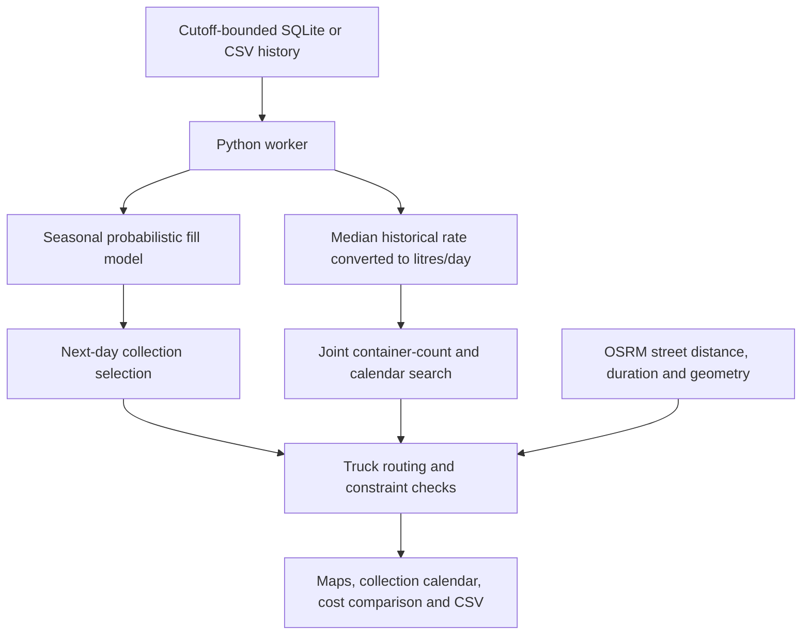

# Glass collection: prediction, inventory optimization and routing

This document describes the active implementation in `Solution/` for a data scientist reviewing the methodology or extending the models. Paths are relative to the repository root. The implementation was reviewed at commit `a7bf4ac`, merged into `main` as `402a80d`.

## 1. What the application does

The application supports two related decisions:

1. **Operational forecasting:** estimate current/future fill, identify containers requiring collection, and propose the next collection day's truck routes.
2. **Inventory and frequency design:** choose physical container counts and collection dates per site/glass type, then evaluate daily truck routes and financial cost over a repeating operating cycle.

**Important: these currently use different demand models.** Operational forecasting uses a seasonal probabilistic model. The joint inventory/scheduling optimizer uses constant incoming volume inferred from median ordinary historical filling rates. The seasonal model is not currently the demand engine of the joint optimizer.



## 2. Source-code map

| Component | Active source | Main entry points |
| --- | --- | --- |
| Python request adapter | [worker.py](Solution/forecast_service/worker.py) | `readings`, `fit`, `proposal`, `forecast`, `selected_day_state`, `simulation`, `capacity_scenario` |
| Seasonal prediction model | [forecast.py](Solution/forecast_service/vendor/fillinq/forecast.py) | `RateModel.fit`, `predict`, `fill_quantile`, `days_to_full` |
| Cycle construction | [data.py](Solution/forecast_service/vendor/fillinq/data.py) | `build_intervals` |
| Input validation and source isolation | [dataset.py](Solution/forecast_service/integrations/dataset.py) | `source` |
| Calendar features | [calendar_features.py](Solution/forecast_service/vendor/fillinq/calendar_features.py) | School-vacation/calendar feature tables |
| Next-day collection selection | [policy.py](Solution/forecast_service/vendor/fillinq/policy.py) | `assess_bins`, `select_stops` |
| Constant-volume demand and manual scenarios | [capacity_planning.py](Solution/forecast_service/integrations/capacity_planning.py) | `demand_streams`, `filling_summary`, `run_schedule`, `compare` |
| Joint inventory/calendar optimizer | [joint_planning.py](Solution/forecast_service/integrations/joint_planning.py) | `stream_gap`, `seed_choice`, `refine_choice`, `master`, `evaluate`, `optimize` |
| Truck-route optimization | [routing.py](Solution/forecast_service/vendor/fillinq/routing.py) | `plan_routes`, `_solve`, capacity checks |
| Compact truck service areas | [territories.py](Solution/forecast_service/vendor/fillinq/territories.py) | `compact_sectors` |
| Street-network access and cache | [roads.py](Solution/forecast_service/vendor/fillinq/roads.py) | `RoadNetwork.matrix`, `route`, `access` |
| Operating-cost arithmetic and fill-time explanations | [planning_insights.py](Solution/forecast_service/integrations/planning_insights.py) | `operating_cost`, `fill_timing` |
| Operating parameters and validation | [OperationsSettings.cs](Solution/apps/api/Features/Proposal/OperationsSettings.cs) | Defaults, limits and request overrides |
| Joint-planning HTTP contract | [CapacityPlanning.cs](Solution/apps/api/Features/Proposal/CapacityPlanning.cs) | `CapacityScenarioRequest`, `/api/capacity-scenario` |
| API-to-Python process bridge | [PythonForecastEngine.cs](Solution/apps/api/Features/Proposal/PythonForecastEngine.cs) | JSON through stdin/stdout; cancellation and time limits |
| Automatic planning interface | [CapacityPlanning.vue](Solution/apps/web/app/features/proposal/components/CapacityPlanning.vue), [JointPlanningResults.vue](Solution/apps/web/app/features/proposal/components/JointPlanningResults.vue) | Controls, inventory/frequency recommendations, daily maps and CSV |

The active bundled Python engine is `Solution/forecast_service/vendor/fillinq/`. Other project folders at repository root are reference snapshots; changing them does not update this application's runtime engine.

## 3. Dataset and observation semantics

The current SQLite source is [Solution/sql.db](Solution/sql.db):

- `raw_data`: `Location_id`, `material_type`, `date`, `fill_level_perc`.
- `locations`: `location_id`, `latitude`, `longitude`, `is_synthetic`.
- Current snapshot: 11,701 observations, 449 locations and 1,338 distinct site/material pairs.
- Glass types: brown, green and white.

A modelled stream is identified by **location + material**, not location alone. A stream is not necessarily a verified count of physical containers. Physical container counts are explicit scenario inputs. Legacy SQLite unknown fills are retained as visit evidence; the uploaded CSV validator accepts integer 0–100 fills or `overfull`, and does not accept an arbitrary unknown-fill string.

A reading is interpreted as the fill observed **before emptying during a recorded collection visit**. Consecutive visits define filling cycles. The visit resets the modelled contents; residual contents after emptying are not measured.

| Observation | Treatment |
| --- | --- |
| Ordinary numeric fill below 100% | Exact endpoint under the cycle assumptions |
| Numeric 100% | A censored/lower-bound observation for rate estimation |
| Explicit `overfull` | A censored/lower-bound observation; never invented as 110% |
| Unknown fill | Evidence of a visit/reset, without a numeric rate |
| Numeric zero | Retained as zero in the joint optimizer; the seasonal training path has a separate floor described below |

History cutoffs are inclusive. Later observations must not enter training, state estimates or scenario demand. Application requests read the source database without writing collection events, forecasts or plans back into it.

### Geographic provenance

The demo now uses 314 official Karlsruhe city glass-container points and 135 surrounding Landkreis points. Existing anonymized history UUIDs were assigned to these coordinates synthetically. Every assignment remains `is_synthetic = 1`.

**Real street coordinates and road distances do not establish that the supplied collection history belongs to those sites.** Financial and routing results must retain this limitation.

Sources, district labels and exact UUID assignments are documented in [karlsruhe-locations.md](Solution/docs/karlsruhe-locations.md) and [location-assignments.csv](Solution/data/karlsruhe/location-assignments.csv).

## 4. Operational prediction model

`RateModel` models daily percentage filling rate for a cycle as lognormal:

```text
log(R_cycle) ~ Normal(a_stream + b_month + g × vacation_share, sigma²)
fill after d days = min(100, R_cycle × d)
```

- `a_stream`: site/material effect, partially pooled toward its glass-type mean.
- `b_month`: month-of-year effect.
- `g`: school-vacation effect.
- `sigma`: cycle variation; uncertainty in stream effects is also included in predictions.

Parameters are fitted using maximum a posteriori estimation with SciPy L-BFGS-B and analytic gradients. The implementation selects `sigma` from a grid, estimates the between-stream shrinkage scale and refits.

Full/overfull cycles contribute censored likelihood terms rather than exact rates. Streams with sparse histories borrow information from their material group. Fits are request-local; there is no persistent trained-weight artifact or shared mutable model singleton.

### Outputs

- Expected fill, capped at 100%.
- Probability of reaching thresholds such as 70%, 90% and 100%.
- 10th/90th percentile model bands.
- Estimated time to full.

The selected-day state treats a recorded visit on that day as emptied, then models subsequent accumulation. Choosing a date or generating a proposal does not execute a collection.

### Points to review

- `build_intervals` applies `MIN_FILL_FLOOR = 2.5` percentage points to numeric fills before computing rates for the log-rate model. This affects zero/very-low observations and should be assessed for bias.
- Time-to-full uses the reset month's seasonal effect as an approximation rather than integrating every future day's seasonal effect.
- Model bands and overflow probabilities are not established as calibrated operational guarantees.
- Calendar features are configured for Baden-Württemberg with finite date coverage; review school-vacation coverage and update it for different regions/years.

## 5. Demand used by inventory/schedule optimization

The joint optimizer deliberately uses a simpler, auditable constant-volume model. For each site/material stream:

```text
cycle percentage rate = next ordinary pre-emptying fill / days since preceding visit
stream percentage rate = median of eligible cycle rates
incoming litres/day = stream percentage rate / 100
                      × baseline physical container count
                      × litres per physical container
```

Eligibility requires a positive elapsed interval and an ordinary numeric endpoint. Unknown, numeric-full and explicit-overfull endpoints are excluded from exact-rate estimation. Zero rates are retained without the seasonal model's 2.5-point floor. No material-level borrowing supplies missing rates here.

The baseline count states the assumed physical capacity represented by the historical percentage. **Changing alternative counts must change capacity, not incoming glass volume.** Both evaluated plans receive the same litres/day.

Streams without an eligible rate are reported as unsupported. Their demand and expense are excluded from the modelled scenario, but their assumed baseline containers reserve space in the site's total-container bound.

### Filling-time graph

For each positive-demand stream:

```text
estimated days to full = scenario storage capacity / incoming litres/day
```

The material-level graph is the arithmetic mean of these times across supported positive-demand streams, giving each stream equal weight. It is not the mean observed collection interval and is not weighted by the number of recorded visits. Zero-demand streams have no finite time-to-full.

## 6. Joint count and calendar optimization

The goal is to choose physical counts and per-type collection dates, then minimize evaluated expense while meeting service constraints.

The automatic planner uses OR-Tools CP-SAT and its routing solver. Gurobi-related modules support separate bounded comparison checks.

### Decision variables and bounds

The CP-SAT master chooses integer container counts per stream and binary visit indicators on operating dates. Due glass types at one site share a truck stop; they do not have to share collection frequency.

Default scenario bounds:

| Parameter | Default | Meaning |
| --- | ---: | --- |
| Repeating cycle | 4 weeks | Configurable from 1–8 weeks |
| Maximum expected fill | 90% | Deterministic target, configurable from 50–100% |
| Containers per site/type | 1–3 | At least one for a type present in the model; maximum configurable |
| Total containers per site | At most 9 | Per-site overrides are supported |
| Collection gaps | 1–28 calendar days | Configurable; cannot exceed the repeating cycle |

These are scenario bounds, not verified physical space or contractual service limits. The cycle length limits the longest collection interval that can be searched.

### Search stages

1. Build calendars using the selected operating weekdays. Glass accumulates on non-working days too.
2. Search service-cost and inventory-first strategies with CP-SAT. Each master solve currently has a six-second limit and four workers.
3. Require a sufficiently recent prior collection on every day, including across the cycle boundary, so expected fill stays within target.
4. Guide the search with a service-time fleet proxy reserving 40% of the shift for driving/unloading. Conservative per-type payload/volume shares guide admissible gaps. These are search approximations, not optimality certificates.
5. Use constructed calendar candidates if a bounded master solve has no incumbent, then check physical bounds and actual routes.
6. Remove surplus containers that cannot affect the calendar's peak occupancy, and remove redundant visits when gap limits still hold.
7. Evaluate daily street routes, service time, loads, compartments and working shifts. Failed visits remain pending and do not empty their streams.
8. Accept only candidates with no spill, no target violations, no pending work, valid count/gap bounds and matching cyclic start/end stock.
9. Keep an eligible baseline as an incumbent. Rank evaluated eligible candidates by priced expense, then installed containers, working hours and road distance. Verify returned street geometry and shift duration before offering dispatch routes.

The operating cycle starts with calendar-dependent **cyclic stock**, not today's measured occupancy. Matching start/end stock ensures the entire incoming cycle volume is collected; a plan cannot appear cheap by leaving extra glass beyond the horizon. A transition from current occupancy into the proposed repeating cycle is not currently planned.

The output is **best feasible found**, with `globalOptimalityProven = false`. A master solver reporting `OPTIMAL` concerns its proxy model, not the complete joint street-routing problem. Failure to return a verified plan does not prove every possible real-world schedule infeasible.

## 7. Street-routing engine

Daily routing uses OR-Tools' routing solver with OSRM car-profile distance and duration matrices. Compact service sectors coordinate truck assignments across unloading trips.

Checks include:

- Payload and configured total vehicle volume.
- Brown/green/white compartment capacities, when all three are supplied.
- Physical containers emptied × service minutes per container.
- Driving, optional stop overhead, unloading and final yard return within the shift.
- Road connectivity and snapping/access checks.

A truck may unload and continue with another load during the same paid day. The current model requires a single site's selected batch to fit one load; splitting that batch across trucks is not implemented.

The routing search minimizes driving distance while enforcing the service constraints. The outer joint search compares the resulting financial expense. Missing coordinates or unavailable street routing do not become aerial-distance routes. Car-profile paths do not certify truck-specific height, weight or access permissions.

`OSRM_BASE_URL` configures the road server; `ROAD_ROUTING_CACHE` configures the independent street-fact cache. Cold public-service calls can dominate execution time. Test doubles replace the street service in unit tests.

## 8. Financial model and operating defaults

**Provider-confirmed: €500 per scheduled truck-day includes truck, driver and driving kilometres.** Zero additional €/km means included driving, not an unpriced fuel category.

```text
period expense = truck-days × truck-day package
               + road kilometres × explicitly entered additional €/km
               + installed containers × monthly container expense
                 × period days / 30.4375
```

Container rental/ownership is unpriced until entered. An additional kilometre rate is only for an expense outside the package and must not double-count included driving. Monthly equivalent scales the priced cycle expense to 30.4375 days; it is not a validated seasonal or annual forecast.

Other current defaults include 3 m³ per physical container, 12 t payload, 8-hour shifts, 5 minutes per container, 15 minutes per unload, Monday–Friday operation and at most 12 available vehicles. Glass density defaults to 350 kg/m³. Unknown truck/compartment volume remains unknown rather than an invented layout. Defaults and validation live in `OperationsSettings.cs`; verify these assumptions with the provider.

### Recorded integration example

For the snapshot through 30 September 2026, one four-week run with the 90% target gave:

| Metric | Weekly baseline | Recommended candidate |
| --- | ---: | ---: |
| Supported site/type streams | 1,298 | 1,298 |
| Modelled physical containers | 1,298 | 1,474 |
| Paid truck-days | 80 | 48 |
| Priced truck-package expense | €40,000 | €24,000 |
| Incoming/collected volume | 2,027,918.802 L | 2,027,918.802 L |
| Spill / fill-target violations | 0 / 0 | 0 / 0 |

The €16,000 difference is **modelled truck-package expense only**. The 176 additional containers are unpriced, 40 unsupported streams are excluded, site/history assignments are synthetic and constant incoming demand is assumed. It is not measured savings or a complete financial optimum. Bounded solver results can vary.

## 9. API and reproduction

The .NET API bounds source observations by `asOf`, validates parameters and sends request-local JSON to the Python worker. Results return as JSON to the Nuxt interface. Automatic optimization has an eight-minute engine limit; manual comparison retains four minutes.

Relevant endpoints:

| Endpoint | Purpose |
| --- | --- |
| `GET /api/fill-state?asOf=...` | Selected-day fill after recorded emptyings |
| `GET /api/forecast?asOf=...&locationId=...&material=...` | Individual seasonal forecast curve |
| `GET /api/proposal?asOf=...` | Next collection-day proposal and routes |
| `GET /api/simulation?asOf=...&start=...&end=...` | Policy comparison over a historical window |
| `POST /api/capacity-scenario?asOf=...` | Manual comparison or automatic joint planning |

For automatic planning, save this example as `joint-request.json`:

```json
{
  "optimize": true,
  "optimizationWeeks": 4,
  "targetFillPercent": 90,
  "baselineIntervalDays": 7,
  "baselineContainers": { "brown": 1, "green": 1, "white": 1 },
  "maxContainersPerType": 3,
  "maxContainersPerSite": 9,
  "minIntervalDays": 1,
  "maxIntervalDays": 28,
  "containerCostPerMonthEuro": 0,
  "overrides": [],
  "siteLimits": []
}
```

With the local API running:

```sh
curl --fail-with-body --max-time 500 \
  -H 'Content-Type: application/json' \
  --data-binary @joint-request.json \
  'http://localhost:5080/api/capacity-scenario?asOf=2026-09-30' \
  -o joint-result.json
```

Inspect `optimization.status`, `globalOptimalityProven`, `recommendations`, `collections`, candidate checks, `scenarios[].feasible`, target violations, cyclic stock stability and the cost breakdown. Do not evaluate only the headline total.

From `Solution/`, `make setup` prepares dependencies and `make run` starts the application. Record exact Python, scientific-library and solver versions when reproducing results; the requirements file specifies minimum versions rather than a fully locked scientific environment.

## 10. Validation and suggested data-science work

The recorded application checks comprise 491 passing tests: 216 API, 6 AppHost, 175 frontend/tooling and 94 Python tests, plus type checking and builds. Test success establishes implemented behavior, not statistical validity or real-world savings.

Targeted checks from `Solution/`:

```sh
.venv/bin/python -m pytest -q \
  forecast_service/tests/test_joint_planning.py \
  forecast_service/tests/test_capacity_planning.py \
  forecast_service/tests/test_planning_insights.py \
  forecast_service/tests/test_selected_day_state.py \
  forecast_service/tests/test_standalone.py

make check
```

Review priorities:

1. **Validate observation semantics and physical inventory.** Confirm pre-emptying readings, complete resets, actual container counts/capacities, geographic assignments and site space limits.
2. **Validate demand and censoring treatment.** Assess the seasonal rate floor, sparse histories, bias from excluding full/overfull endpoints in the constant-rate optimizer and the treatment of zero demand.
3. **Evaluate forecasting chronologically.** Use time-based holdouts with training strictly before evaluation; compare site/material median-rate and persistence baselines. Report errors and probability calibration by glass type and data-coverage group.
4. **Connect probabilistic demand to planning.** Consider daily seasonal volume scenarios and robust/chance constraints. A deterministic 90% target is not a calibrated overflow-risk guarantee.
5. **Add current-stock transition planning.** Separate long-term cyclic design from the first weeks of executing it against actual occupancy and current physical inventory.
6. **Strengthen optimization quality evidence.** Study candidate diversity, route-aware scheduling, the 40% time reserve, conservative load shares, solver budgets and stability across repeated runs. Compare small instances with stronger/exact benchmarks.
7. **Complete financial inputs.** Obtain container ownership/rental expense and confirm which expenses and shift arrangements the €500 package covers.
8. **Validate in a real pilot.** Use verified locations, actual truck access, actual loads and observed service times. Keep modelled comparisons separate from measured operational outcomes.

Additional implementation detail: [joint planning](Solution/docs/architecture/joint-planning.md), [capacity scenarios](Solution/docs/architecture/capacity-planning.md), [planning insights](Solution/docs/architecture/planning-insights.md) and [selected-day semantics](Solution/docs/architecture/selected-day-fill.md).
