# ♻️ Smart Waste Routing — City of Heilbronn (PreZero / Fillinq Challenge)

AI-driven dynamic route optimization for municipal glass recycling containers in Heilbronn, transitioning from fixed-schedule collection to demand-responsive collection.

---

## 🏗️ Architecture & Modular Pipeline

The project is structured into **4 decoupled notebooks** communicating through persistent intermediate artifacts in `data/`, powered by reusable core logic in `src/`:

```mermaid
flowchart LR
    A["glass_fill_levels_anonymized_f.csv"] --> NB1["01_eda_and_analysis.ipynb"]
    NB1 --> D1["data/cleaned_fill_levels.csv"]
    D1 --> NB2["02_container_clustering.ipynb"]
    NB2 --> D2["data/container_clusters.csv"]
    D2 --> NB3["03_fill_prediction.ipynb"]
    NB3 --> D3["data/predicted_demands.csv"]
    D3 --> NB4["04_gurobi_route_optimization.ipynb"]
    NB4 --> MAP["route_proposal.html (Folium)"]
```



### Why this modular structure?
* **Decoupled execution:** If you want to experiment with different clustering features or change K-Means to DBSCAN in Notebook 02, you **do not** need to re-run the EDA or data cleaning.
* **Fast optimization iterations:** Notebook 04 loads `predicted_demands.csv` instantly, allowing you to test Gurobi parameters (shift lengths, vehicle capacities, time limits) in seconds.

---

## 📓 Notebook Guide

1. **[01_eda_and_analysis.ipynb](file:///d:/Future_city%20Hackathon/01_eda_and_analysis.ipynb)**:
   * Data cleaning, BOM sanitization, and overfull handling ($110\%$).
   * Glass stream benchmark (White, Green, Brown).
   * Calendar & Baden-Württemberg statutory holidays analysis.
   * Day-of-week collection dynamics.
   * Historical emptying inefficiency audit ($44.4\%$ late vs. $26.2\%$ premature).
   * **Output:** `data/cleaned_fill_levels.csv`.

2. **[02_container_clustering.ipynb](file:///d:/Future_city%20Hackathon/02_container_clustering.ipynb)**:
   * Separates emptying drops from true accumulation velocity ($\Delta F \ge 0, \Delta t > 0$).
   * K-Means behavioral clustering into 4 balanced operational tiers (Chronic Overfillers, High-Demand, Moderate Regular, Low-Demand).
   * Fixes outlier sensitivity and pools per-stream metrics.
   * **Output:** `data/container_clusters.csv`.

3. **[03_fill_prediction.ipynb](file:///d:/Future_city%20Hackathon/03_fill_prediction.ipynb)**:
   * Predicts future fill levels: $\widehat{\text{Fill}}_i(t + \Delta t) = \min(110\%, \text{CurrentFill}_i + v_i \times \Delta t \times S_{\text{holiday}})$.
   * Converts fill percentage into physical volume ($m^3$) and weight ($kg$) based on glass density ($380\text{ kg/m}^3$).
   * Classifies urgency: Urgent ($\ge 80\%$), Opportunistic ($60-79\%$), Safe ($< 60\%$).
   * **Output:** `data/predicted_demands.csv`.

4. **[04_gurobi_route_optimization.ipynb](file:///d:/Future_city%20Hackathon/04_gurobi_route_optimization.ipynb)**:
   * Implements all **7 challenge operational variables** in a Gurobi Mixed-Integer Linear Program (MILP) CVRP.
   * Incorporates dual capacity (weight & volume) and driver shift limits ($7.5\text{ h}$, $6\text{ min}$ service time).
   * Miller-Tucker-Zemlin (MTZ) subtour elimination.
   * Determines optimal fleet size and outputs turn-by-turn routes.
   * Interactive Folium map generation: `route_proposal.html`.

---

## 🚀 Setup & Execution

### 1. Activate Environment
```powershell
.\.venv\Scripts\Activate.ps1
```

### 2. Gurobi License Activation
Gurobi 14.0.0 is installed in `.venv`. To activate your unrestricted educational license:
* **Option A (License Key):** If you received a `grbgetkey` command from Gurobi:
  ```powershell
  grbgetkey <YOUR-KEY-STRING>
  ```
* **Option B (gurobi.lic file):** Place your `gurobi.lic` file in your user home directory (`C:\Users\Zakaria\gurobi.lic`) or set:
  ```powershell
  $env:GRB_LICENSE_FILE = "d:\Future_city Hackathon\gurobi.lic"
  ```
