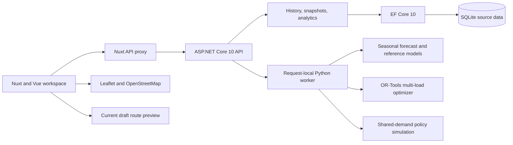

# Garbage Collector — Product and Architecture

Last consolidated: 14 November 2026.

This document records product decisions and remaining operational extensions. The [challenge handover](docs/challenge-demo-guide.md) is the current deliverable checklist and verified demo path; [the integration contract](docs/combined-project-integration.md) describes the connected Python engines. See [README.md](README.md) for local setup and [UI component architecture](docs/architecture/ui-components.md) for the detailed frontend breakdown.

## 1. Purpose and challenge scope

Garbage Collector helps waste collection teams inspect glass-bin history, choose individual bins for collection, group them into physical stops, and plan routes that reduce collection time.

The initial region is Heilbronn. Each location has separate **brown, green, and white glass bins**. The primary user is a dispatcher or collection planner; collector-facing manifests support the hand-off. Mobile field reporting, driver dispatch, and collection-completion recording are future capabilities.

The application uses actual historical observations and clearly labeled predictions. Omar's forecast, selection, multi-load routing and simulation are connected through a request-local Python worker, with Kaise's validation/grouping and Zakaria's corrected reference policy and bounded optimization check.

The challenge has two connected decisions:

1. **Which bins need collection?** Cutoff-safe forecasts and risk-based prioritization.
2. **How should the selected bins be collected efficiently?** Route planning and operational constraints.

Routing can also be demonstrated using a manually chosen set of bins. The uploaded challenge brief's ingestion, pattern visualization, configurable routing/fleet and documentation deliverables are mapped to the running prototype in the handover guide.

## 2. Architecture decisions

| Area | Decision |
| --- | --- |
| Backend | ASP.NET Core 10, C#, feature-oriented modular monolith |
| Data access | Entity Framework Core 10 with SQLite provider |
| Persistence | SQLite; current application access is read-only |
| Frontend | Nuxt 4, Vue 3, TypeScript |
| Package manager | **pnpm**, using the version pinned in `apps/web/package.json` |
| UI system | **Project-owned Vue components and CSS**, following `idea of UI:UX`; no Onyx dependency |
| Map display | Leaflet using OpenStreetMap data/tiles |
| API | REST/JSON with an OpenAPI document |
| Frontend/backend connection | Nuxt server proxies allowlisted GET requests and analysis POST requests to ASP.NET |
| Current route preview | Nearest-neighbor/manual ordering and straight-line geographic distance, calculated in the frontend |
| Constrained routing | Python OR-Tools multi-load routes with total payload/volume and shift constraints; road-network travel and separate compartments remain extensions |

Use one backend application with clear feature boundaries. The API invokes a request-local Python subprocess through JSON; frontend code does not implement the optimization model.

## 3. Confirmed data semantics

### Location, bin, and collection stop

- `Location_id` is a stable location UUID.
- A **bin** is identified by `(Location_id, material_type)`.
- Coordinates belong to the location and are shared by its glass bins.
- Selection operates on individual bins. Selected bins at the same location form one route stop.
- A missing location/material history is not evidence of an empty bin. Do not invent an observation or fill percentage.

### Historical observations

The original history was manually collected in Excel and transferred into SQLite. The application reads SQLite and supports request-local CSV upload for forecasts, routes and simulation. Uploads do not change the source database or the original history/inventory modules.

**Every recorded fill level was taken immediately before emptying the corresponding bin.** Each row therefore represents a pre-emptying measurement and a collection occurrence on that date.

Consequences:

- Label readings as **fill before emptying**, never as current contents.
- Do not detect collections from decreases between readings; the recorded observations already correspond to collections.
- Do not estimate accumulation from the difference between consecutive pre-emptying percentages: a collection occurred between them.
- Whether collection always resets a bin to exactly 0% is unconfirmed. No measured post-emptying level is available.
- Dates have day precision only. Do not invent times of day, truck visit order, or live telemetry.

### Explicit overfull category

`fill_level_perc` contains numeric strings and the literal category `overfull`.

| Source value | Numeric percentage | Overflow flag | Display |
| --- | --- | --- | --- |
| `0` through `100` | Parsed percentage | false | Recorded percentage |
| `overfull` (case/whitespace normalized) | null | true | Overfull at collection |
| Missing, malformed, or out-of-range numeric value | null | false | Unknown |

Never silently classify `overfull` as missing, clamp it to 100%, or replace it with an invented 110%. Keep unknown data distinct from zero and overflow. Preserve the original source records.

The history API exposes `isOverfull`; planning summaries expose `lastIsOverfull`. Cards, history, manifests, filtering, sorting, and CSV export preserve this distinction. Overfull observations are not plotted as invented numeric chart points.

## 4. Historical planning and information isolation

The user selects a planning date and clicks **Apply date**. The picker allows dates from the earliest observation in SQLite through seven days after its latest observation, inclusive. If the initial date is outside that range, it opens on the latest recorded date. An empty database disables date selection. Global `/api/data-range` metadata supplies navigation bounds only; historical results remain filtered by the selected cutoff. The current application implements an **inclusive end-of-day replay**:

```text
eligible observation.date <= selected asOf date
```

The backend filters observations in SQLite and applies the cutoff again when building summaries. Frontend transformations reject snapshots for the wrong cutoff and exclude later readings.

Apply the cutoff to:

- Known bins and visible planning locations.
- Latest readings and collection counts.
- Date ranges, analytics denominators, monthly metrics, and coverage indicators.
- Location detail history and charts.
- Bin selection and collection plans.

History's `asOf` upper bound still applies when a later `to` date is requested. A date change immediately clears selected bins, the current inspection, manual stop order, and collector notes. Data is not deleted from SQLite. Selections persist when switching modules at the same cutoff.

The `/api/locations` endpoint supplies static coordinate metadata; the planning map joins it only to bins known at the cutoff. A location first observed after that cutoff must not appear as a known historical bin location.

**Evaluation distinction:** end-of-day replay is useful for exploration. A fair morning-dispatch or forecasting benchmark must exclude measurements that become available only during that day's collections. A decision timestamp/start-of-day policy is future work; the existing inclusive replay must not be presented as a morning decision simulation.

## 5. Current database and coordinate transition

The source database is `sql.db`. The API opens it read-only, fails if it is missing, and runs no startup migrations, seeding, or automatic table creation. `raw_data` is an EF keyless entity because the source table has no primary key.

### Existing schema

| Table | Fields |
| --- | --- |
| `raw_data` | `Location_id TEXT`, `material_type TEXT`, `date TEXT`, `fill_level_perc TEXT`; all required |
| `locations` | `location_id TEXT PRIMARY KEY`, `latitude REAL`, `longitude REAL`, `is_synthetic INTEGER`; required values and coordinate-range checks |

A snapshot checked during this consolidation contains:

- **11,701** observations across **449** location UUIDs.
- **1,338** observed location/material pairs. Three possible colors per location do not imply complete recorded history for every pair.
- Observation dates from **17 October 2025 to 30 September 2026**.
- **1,192** explicit overfull observations.
- All **449** current coordinate mappings are synthetic.

`sql.before-locations.db` preserves the database from before synthetic locations were added.

### Real coordinates: next external dependency

The user expects real coordinates **tomorrow**. Relative to this document's consolidation date, that is **15 November 2026**; delivery remains pending until the mapping is supplied and verified.

Proposed exchange format:

```text
Location_id, latitude, longitude, [address]
```

Use WGS84 latitude/longitude in degrees; confirm the supplied coordinate reference system and coordinate order.

Planned import workflow, not yet implemented:

1. Back up the database and stage the mapping.
2. Match by existing UUID; do not regenerate location or bin identities.
3. Validate required values, duplicate UUIDs, coordinate order/ranges, and plausible regional coverage.
4. Report unmatched source IDs, missing mappings, and extra IDs explicitly.
5. Replace matched synthetic coordinates and mark verified real mappings `is_synthetic = 0` in a controlled transaction.
6. Preserve observations and any remaining synthetic/unmatched flags. Do not silently label unresolved coordinates as real.
7. Propagate the stored real/synthetic flag through frontend bin/stop models, map labels, and CSV. Derived bin, stop, map, and CSV models now preserve the stored flag. The default depot remains a separately configured synthetic point.
8. Verify map markers and route inputs, then rerun routing benchmarks.

The coordinate import should use a separate administrative/import path. Routine application startup remains read-only. The notebook's independently generated synthetic mapping must not replace the application's mapping accidentally.

## 6. Current module boundaries

| Module | Responsibility and implementation status |
| --- | --- |
| History | Implemented: query validation, inclusive date/location/material filtering, stable pagination, numeric parsing and overflow flags |
| Planning snapshot | Implemented: latest eligible observation and collection count per location/material |
| Historical analytics | Implemented: material/monthly comparisons and charts, exact partial periods, distributions, intervals, cycle rates, review flags and sparse-history indicators |
| Planning workspace | Implemented: search, material and historical-fill filters, grouped location cards, map inspection, individual/group selection |
| Location details | Implemented: source metadata, glass-bin cards, actual observation chart and audit history |
| Collection manifest | Implemented: grouped stops, manual reordering, draft notes, nearest-neighbor reset, CSV export and browser print/PDF |
| System status | Implemented: actual API health and snapshot availability; unavailable integrations labeled honestly |
| Forecasts | Implemented: seasonal cycle model, uncertainty curves, risk-based selection, behavioral groups and matched held-out references |
| Operational routing | Implemented: multi-load OR-Tools routes and constrained simulation; road-network paths and compartment constraints remain planned |
| Import and saved plans | Request-local validated CSV upload implemented; durable imports and saved-plan storage remain planned |

## 7. Data flow and responsibility split



The backend owns persistence access and historical interpretation/validation. Nuxt's server proxy forwards allowlisted requests; it is not a second database or forecasting backend.

The frontend owns presentation, transient workspace state, and the manual geographic route preview. Forecasts, constrained routes and simulations run behind the API. Do not duplicate their business rules in individual Vue components.

### Existing API surface

| Endpoint | Contract |
| --- | --- |
| `GET /api/health` | Verifies access to both required source tables |
| `GET /api/data-range` | Global first/last observation dates and last date + 7 days for planning navigation |
| `GET /api/locations` | Coordinate metadata and synthetic flags |
| `GET /api/planning?asOf=yyyy-MM-dd` | Required cutoff; eligible bins, latest readings, overflow flags, counts, and date bounds |
| `GET /api/history` | Optional location, material, date bounds and cutoff; page defaults to 1, page size to 50, maximum 200 |
| `GET /api/analytics?asOf=yyyy-MM-dd` | Required cutoff; historical material/monthly metrics |
| `GET/POST /api/proposal`, `/api/forecast`, `/api/simulation` | Original-data or uploaded-data routes, per-bin curves and shared-setting evaluation; see the integration contract |
| `GET /openapi/v1.json` | Backend OpenAPI contract |

History dates use `yyyy-MM-dd`; material values are `brown`, `green`, and `white`. DTOs expose parsed domain information rather than requiring the frontend to interpret raw database entities. A generated TypeScript API client is a possible later improvement, not currently implemented.

## 8. Historical analytics and notebook interpretation

`main.ipynb` supplies exploratory ideas. Its conclusions are not automatically production rules.

Implemented metrics:

- Collections and overfull-at-collection counts/rates by glass type.
- Numeric mean pre-emptying fill with its numeric sample count. Exclude overfull and unknown values from the mean; show their counts separately.
- Median interval between consecutive **distinct recorded collection dates**, calculated within each location/material pair and pooled by material. Single-observation bins contribute no interval.
- Descriptive fill bands: 0–30%, above 30/below 70%, 70/below 100%, exactly 100%, overfull, and unknown.
- Monthly collection comparisons, with explicit partial-month caveats at the selected cutoff.
- Interactive monthly charts, reset-aware numeric cycle medians with separate censored-cycle counts, and transparent historical review flags linked to location history.
- Known-bin coverage and the number of bins with fewer than three observations. This is a coverage indicator, not forecast confidence.

The fill slider filters the latest historical pre-emptying reading. Overfull matches even a 100% threshold and sorts above numeric 100%, without becoming a numeric percentage or current urgency claim.

Notebook assumptions requiring correction or validation:

- Drop-based emptying detection excludes valid collection records and must not be used.
- Differences between pre-emptying readings are not accumulation rates.
- Daily/monthly averages describe observed collection events, not all bins' current network state.
- Holiday effects and operational causes are hypotheses, not demonstrated causal findings.
- Whole-dataset clustering or scaling leaks future information into a past replay; fit using eligible historical inputs only if adopted later.
- Vehicle capacities, glass densities, speeds, compartment splits, and service times are example assumptions until confirmed.

## 9. Forecast integration contract

The implemented JSON/stdin bridge, uncertainty semantics, settings and evaluation isolation are documented in [the forecast architecture](docs/architecture/proposal.md) and [combined integration](docs/combined-project-integration.md). Keep observations, forecasts and collection plans separate.

Any future archived forecast format should include:

- Location UUID and material type.
- Target date/time and prediction unit.
- Predicted fill and/or explicit predicted-overflow status, with agreed bounds and semantics.
- Generation timestamp and historical input/training cutoff.
- Model version and forecast-run identifier.
- Confidence or uncertainty when available; missing confidence must remain missing.

For historical replay, inputs and training must respect the decision cutoff. Archived forecasts must have been available at the relevant decision time. A newly generated retrospective backtest can instead use only the eligible historical prefix; label it as a backtest and preserve its actual generation timestamp rather than pretending it existed in the past. Preserve original model output and provenance. Show observed values and predictions with distinct dates and visual labels.

Current risk thresholds and prediction horizons are configurable. Each recorded visit resets its bin under the stated emptying assumption; unknown visits supply no numeric cycle rate. Archived forecast persistence remains future work.

## 10. Map, road routing, optimization, and evaluation

These are separate responsibilities:

1. **Map display:** Leaflet renders OpenStreetMap tiles, locations, and route geometry. The current public tile endpoint is for local demonstration; an appropriate operational tile provider still needs to be selected.
2. **Road routing:** a future service returns legal road paths, distances, and travel times between depots/stops. Heavy-vehicle restrictions need appropriate data/profile support.
3. **Route optimization:** choose stop order using travel times and confirmed constraints.

Current preview: group selected bins by location, order stops using geographic nearest-neighbor distance or manual movement, and connect depot → stops → depot with dashed straight lines. The city-center depot is synthetic. Displayed kilometers are geographic distance, not driving distance. There are no driving ETAs, proven global optimum, or measured time savings.

Target operational inputs:

- Real bin coordinates and configurable start/finish depots.
- Road distance/time matrix and routing profile.
- Vehicle count, payload and volume limits, separate glass compartments.
- Bin capacity, service time per stop/bin, shift duration, unloading points and any confirmed time windows.
- Explicit handling of unknown fill/volume and categorical overflow; do not derive exact payload from an invented overflow percentage.

Benchmark using the **same selected bins, depot, travel-time matrix, and constraints** for baseline and proposed routes. Report distance, estimated travel plus service time, and constraint feasibility. Date-only source records do not reveal the original truck visit order; use a clearly labeled baseline or obtain the actual historical route. Do not claim percentage savings from synthetic-coordinate demonstrations.

## 11. UI architecture and design sources

The uploaded `idea of UI:UX/` folder informs the navigation rail, neutral/green palette, compact data typography, glass-fraction cards, split list/map workspace, route drawer, detail page, manifest, and system states.

Use project-owned Vue components under `shared/ui/controls` for buttons, icons, fields, segmented filters, sliders, checkboxes, cards, badges, tables, pagination, and recovery states. The sidebar is a fixed icon rail; `CollectionDatePicker` implements the calendar with strict service-day bounds. Shared CSS owns the visual language, directly informed by `idea of UI:UX`. Onyx dependencies and its Nuxt module have been removed at the user’s request. Leaflet, semantic progress meters, and the historical SVG dot chart remain domain-specific visuals.

Small components are colocated under `features/{planning,history,inventory,manifest,analytics,map,system}/components`, with the shell in `components/layout` and stateless shared presentation in `shared/ui`. `features/workspace/model.ts` composes independent data, filter, plan, and navigation models; `composables/useCollectionWorkspace.ts` supplies Nuxt requests and narrow injected capabilities. Secondary modules are loaded lazily.

State rules:

- No shared mutable per-user state at module scope during server rendering.
- One workspace maintains selections across module navigation.
- A date change clears the draft immediately and hides stale responses.
- Individual glass-bin selection is preserved when bins are grouped into stops.
- Reordering updates the map, distance, manifest, and export together.
- Unknown values stay explicit; loading, empty results, and failed requests have distinct states.
- Fraction color is paired with text/icons. Controls must remain keyboard-accessible and responsive.

The design's fictional users, addresses, trucks, live sensors, capacities, forecasts, savings, and operational status messages are not application data. The project remains named Garbage Collector; adopting the visual language does not imply an endorsed PreZero deployment.

## 12. Persistence evolution — proposed, not migrated

Keep source history intact. New writable features require an explicit migration/import workflow, backup, and verification; do not add automatic source mutations during normal startup.

Potential future entities:

| Entity | Intended role |
| --- | --- |
| Bin inventory | Explicit bin ID with unique location/material identity and confirmed capacity |
| Imported observations | Source/import identity, collection date, raw fill, parsed percentage and overflow status |
| Coordinate import/version | Mapping provenance and real/synthetic distinction |
| Forecast run and forecast values | Model/version, generation and training cutoff, bin/target-date results |
| Fleet/depot configuration | Confirmed vehicles, compartments, depots, service and shift constraints |
| Collection plan, stops, and selected bins | Planning date/cutoff, ordered locations, source readings/forecast run, notes, configuration and coordinate version |

Saved plans should retain enough input/version information to reproduce the original decision after later data imports. The exact schema, writable database arrangement, and authentication model remain open decisions.

Current collector notes and plans live in memory and disappear on reload. CSV exports contain one row per selected bin, original measurement date, nullable percentage, overflow flag, coordinates, and notes. Browser print supports saving a PDF; there is no persisted synchronization, electronic dispatch, or official signed manifest workflow.

## 13. Repository structure

```text
GarbageCollector.slnx
apps/
  apphost/                   # Optional Aspire startup: API, pnpm/Nuxt and local dashboard
  api/
    Api/                      # Endpoint registration
    Domain/                   # Cutoff, fill semantics, observations and locations
    Features/                 # Dataset navigation bounds, History, Planning, Analytics, Locations
    Infrastructure/Persistence/ # EF mappings, read-only setup and SQL cutoff query
    Properties/               # Local launch profile
  web/
    app/
      components/layout/      # Application shell
      features/               # Feature-local components, state, adapters and styles
      composables/            # Workspace provider and narrow capabilities
      shared/                 # API contracts, domain primitives, config, browser effects, UI
      assets/                 # Theme/base/layout/responsive CSS entrypoints
    server/api/               # Allowlisted backend proxy
    pnpm-lock.yaml
scripts/
  test.sh                     # Both suites, using in-process xUnit execution
  smoke-test.py               # HTTP checks against a running API
tests/
  GarbageCollector.Api.Tests/ # xUnit rules and isolated SQLite service tests
  GarbageCollector.TestRunner/ # Socket-free execution of the real xUnit suite
  *.test.mjs                  # Node tests of frontend TypeScript/Vue state logic
docs/
  architecture/
main.ipynb                    # Exploratory analysis; not the production forecasting model
sql.db                        # Existing source data and coordinate mapping
PROJECT_IDEA.md
README.md
```

There is no implemented `packages/api-client`, deployment infrastructure directory, or browser E2E suite yet.

## 14. Mandatory development and testing rule

**Every new or changed piece of application logic must include corresponding unit tests in the same implementation change.** This applies to backend and frontend validation, cutoffs, transformations, analytics, selection, grouping, route planning, and exports.

- Cover expected behavior, relevant boundaries, invalid inputs, missing data, and explicit overflow handling.
- Add a regression test with each bug fix.
- Test that later records cannot alter an earlier snapshot, statistic, or forecast input set.
- Keep logic independently testable. Tests must not modify the source database or require a running server.
- Use separate in-memory SQLite databases for relational service tests.
- Run relevant tests before considering a logic change complete. Report blocked execution and unverified behavior explicitly.
- Type-check and build after relevant application changes. Documentation-only edits do not introduce executable application logic.

Most recently verified: **370 passing tests: 209 API, 6 AppHost, 126 frontend/tooling and 29 Python**, plus frontend type checking and .NET/Nuxt builds. See the challenge handover for live API and browser verification.

Run the full suite:

```sh
./scripts/test.sh
```

The script uses the actual xUnit discovery/execution API in-process because the standard VSTest communication socket is blocked in the implementation environment. Standard `dotnet test GarbageCollector.slnx` remains available in a normal local terminal. NuGet vulnerability auditing stays enabled; an unavailable audit feed can produce `NU1900` warnings.

Live API and browser checks are recorded separately in the challenge handover. External map-provider availability and physical print output are not established by unit tests.

## 15. Deployment and operational boundaries

Local defaults: frontend `http://localhost:3000`, API `http://localhost:5080`.

- `Database__Path` configures the SQLite source path.
- `NUXT_API_BASE` configures the backend origin for Nuxt's server proxy.
- Run the built Nuxt Node server alongside ASP.NET and keep SQLite on a persistent local volume.
- Authentication, user roles, production host/HTTPS configuration, scheduled backups, writable plan storage, operational tile service, and deployment automation remain to be implemented or selected.
- There is no live sensor integration, offline field cache, automatic dispatch, or recorded driver-completion workflow.

Do not present the current prototype as operationally validated while these deployment and routing gaps remain.

## 16. Next milestones and open decisions

| Priority | Milestone | Acceptance evidence |
| --- | --- | --- |
| 1 | Extend browser verification | Automated challenge path covers analytics → details → forecasts → simulation → manifest → CSV and draft reset; extend road-map and physical-print review |
| 2 | Import real coordinates when delivered | UUID coverage report, coordinate validation, verified real/synthetic flags, no source-history changes |
| 3 | Configure actual depot and road routing | Real road geometry and travel-time matrix; unreachable stops handled explicitly |
| 4 | Add confirmed fleet/service constraints | Feasible plans respecting the supplied capacities and operating limits |
| 5 | Benchmark routing | Reproducible comparison using identical stops, depot and assumptions |
| 6 | Extend independent forecast validation | Connected models and cutoff tests exist; use longer held-out periods and measured post-emptying levels |
| 7 | Add durable plans and import tooling | Explicit migrations, backups, tested imports; user roles as required |

Useful later design additions: saved plans, configurable start/finish depots, drag-and-drop stop ordering with keyboard alternatives, a selected-only map/list, undo, collapsible panels, and an improved collector printout. These are candidates, not completed features.

Outstanding decisions include the coordinate delivery format, actual depot, routing engine/profile, tile provider, vehicle/service parameters, forecast delivery and uncertainty contract, whether emptying always resets to zero, urgency policy, evaluation decision time, data-ingestion requirements from the official rubric, persistence migrations, hosting, and user access.

## 17. References

- [Local setup and verification](README.md)
- [UI component and design mapping](docs/architecture/ui-components.md)
- [Code structure and change guide](docs/architecture/code-structure.md)
- [Exploratory notebook](main.ipynb)
- [Uploaded design brief](<idea of UI:UX/project_prd_system_brief.md>)
- [Uploaded design system](<idea of UI:UX/circular_municipal_fleet/DESIGN.md>)
- [ASP.NET Core 10](https://learn.microsoft.com/en-us/aspnet/core/?view=aspnetcore-10.0)
- [Nuxt](https://nuxt.com)
- [OpenStreetMap](https://www.openstreetmap.org)

## 18. Optional Aspire development workflow

Run `dotnet run --project apps/apphost` to start the API, Nuxt through pnpm, and the local Aspire dashboard. The frontend waits for both its frozen-lockfile install and the API database health check. Aspire injects the backend endpoint through `NUXT_API_BASE` and forwards the existing `Database__Path` override. SQLite remains read-only; no database provisioning is introduced. Existing standalone startup commands remain supported.

This integration provides resource status and console logs. Application OpenTelemetry instrumentation remains future work. The AppHost now supports Docker Compose deployment to Linux: the production Nuxt entry point, a private API, a persistent read-only SQLite bind mount, restart policies, and a frontend-to-database health check. See [Linux deployment](docs/deployment/linux-compose.md). See [Aspire architecture notes](docs/architecture/aspire.md). The resource graph builds and its six regression tests pass; a live dashboard/browser run could not be verified in the restricted development environment because local socket binding is denied.

Map display supports MapTiler OMT through its provider-rendered raster tiles in Leaflet. `NUXT_PUBLIC_MAPTILER_API_KEY` enables the normal `openstreetmap` OMT style. Standard OpenStreetMap tiles remain the fallback without a key. There are no CSS basemap color filters. Compose forwards the API key, and provider attribution/logo remain visible. Live MapTiler tile loading awaits a configured key.


### Code navigation and maintainability

[CODE_INDEX.md](CODE_INDEX.md) maps common changes to source files and focused tests. [AGENTS.md](AGENTS.md) is the short entrypoint for coding assistants: use the index, open only relevant modules, and keep the map current when ownership changes.

Analytics table filtering/pagination lives in feature state modules. Shared table sorting publishes field and direction together; Vue table components focus on presentation. The history API separates HTTP binding, query validation, SQL filtering/ordering, parsed fill ordering, and read orchestration. Component interaction tests share a source-aware Vue test helper, with table scenarios kept separately from primitive/calendar scenarios.
