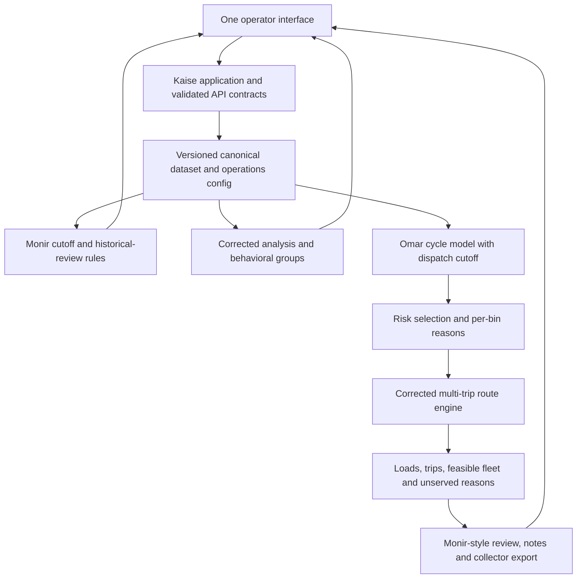

# Project comparison and recommended combination

> **Corrected on 14 November 2026:** see [combined-solution-review.md](combined-solution-review.md) for verified corrections to this document (stale Zakaria details, overstated bug impact, missing truck-volume issue, deadline-aware merge plan). The Zakaria column in the configuration table of section 4 was updated to his current values.

> **Later revision to Zakaria's project:** The comparison below predates the correction task. Zakaria's notebook/Gurobi pipeline has since been corrected and optimized; see its [current method](../Zakaria-Work/docs/corrections-and-method.md) and [verification](../Zakaria-Work/docs/verification.md). The original overflow, growth/reset, historical-cutoff, candidate-accounting and solver-status criticisms are historical. Remaining differences such as one load per vehicle, synthetic geography and the simple forecast baseline still apply.

Reviewed on 14 November 2026 against the [challenge brief](../Readme%20Challenge.pdf), the matching [Solution challenge copy](../Solution/challenge.pdf), current source and the [contributor reports](contributors/README.md).

## Recommendation

**The fastest credible challenge solution is Kaise's application foundation plus Omar's corrected forecasting, selection and routing engine.** Kaise already connects upload, validation, forecasts, candidates, routes, comparisons and documentation. Omar adds a more appropriate model of filling after emptying, probability-based collection decisions, working-day lookahead and routing with shifts and intermediate unloading.

**The strongest broader combination adds Monir's historical workspace and collector-manifest capabilities, with Zakaria leading corrected exploratory analysis and optimization validation.** Incorporating those strengths does not require running four separate products or retaining four competing implementations of each business rule.

No current project has demonstrated a complete, validated solution to every operational question. Combining source folders alone will not achieve that. The integration must reconcile data meaning, common inputs and route accounting, then demonstrate one coherent workflow. The challenge explicitly accepts a working prototype concept; it does not demand production deployment or proof of a globally optimal city-wide solution.

These judgments concern the implementations and their suitability for this challenge, not a ranking of people's ability. Folder-based attribution and local-change limits remain as recorded in the contributor reports.

## 1. What the challenge actually requires

The brief calls for analysis of patterns, behavioral grouping and anomalies/external factors; a usable tool; configurable physical and operating variables; automatic collection routes and fleet recommendations; and four concrete deliverables: upload/processing, pattern visualization, route engine, and architecture/user documentation.

Useful acceptance criteria are:

| Requirement | A convincing demonstration |
| --- | --- |
| Upload and processing | Upload a valid CSV, explain invalid rows, and use the uploaded dataset throughout the application |
| Patterns and groups | Compare glass streams, show observed history/coverage, explain groups and sparse cases |
| External factors/anomalies | Show calendar-related findings and unusual observations with uncertainty; avoid unsupported causal explanations |
| Configurable variables | Change density, container/truck capacity, travel/depot/disposal assumptions and shift; recompute demand and route output |
| Automatic route proposals | Explain selected bins, group physical sites, show truck order, loads, disposal trips and missed service |
| Fleet recommendation | Distinguish demand capacity estimates, available trucks, trucks actually scheduled and remaining demand |
| Documentation | Provide a runnable setup, architecture, assumptions, user walkthrough and interpretation of results |

Actual observation coverage in the saved project reports is 17 October 2025–30 September 2026, less than a full year despite the brief's broader wording. Annual seasonality claims need that qualification. None of the projects establishes real historical GPS mapping or live sensor readings.

## 2. Group the similar work

### Group A — data ingestion, identity and historical evidence

All four use the same basic glass-reading structure: location ID, material, date and fill. All need one logical bin per `(location, material)` and a distinction between observations and forecasts.

- **Monir:** reads an existing SQLite dataset; strong historical cutoffs and domain display rules; no CSV-upload workflow.
- **Kaise:** strict CSV contract, complete validation feedback, upload API and UI; one active dataset per process.
- **Omar:** flexible CSV parsing, normalization and interval preparation; permissively drops/clips some invalid values.
- **Zakaria:** notebook-oriented cleaner and calendar enrichment; no equivalent structured validation response.

**Combine:** Kaise's ingestion boundary and error reporting, Monir's historical cutoff/provenance rules, and an adapter into Omar's model. Preserve raw data; derive numerical model inputs separately.

### Group B — patterns, grouping and calendar analysis

All four describe glass-material differences and historical fill distributions. Omar, Kaise and Zakaria implement behavioral grouping; Monir groups bins into physical collection locations, which answers a different question.

- **Kaise:** the strongest safeguards for descriptive grouping: coverage checks, cluster interpretability criteria and fallback pressure tiers.
- **Omar:** fitted material/container rates, seasonal effects and vacation effects connect analysis directly to forecasts.
- **Zakaria:** a clear four-stage exploratory narrative, stream charts and interpretable tier presentation; several numerical interpretations need correction.
- **Monir:** useful interactive cutoff-safe material/monthly summaries and actual-history inspection.

**Combine:** use Kaise's coverage/gating approach, Omar's corrected cycle-rate features, and Monir/Zakaria's reporting ideas. Recompute group labels after changing feature meaning; do not retain old cluster assignments as validated results.

### Group C — forecasting and collection decisions

Omar, Kaise and Zakaria all turn history into a future numerical signal, but they are not forecasting the same quantity:

| Work | Forecast / decision meaning |
| --- | --- |
| Omar | Filling since the last emptying; probability of reaching capacity before the next service opportunity |
| Kaise | Future observed reading from persistence or historical numerical changes; configurable threshold selection |
| Zakaria | Last recorded percentage plus positive-change velocity and a supplied holiday multiplier; urgency bands |
| Monir | Last observed pre-emptying fill for inspection/manual selection; no connected predictor |

**Combine:** Omar's cycle model and probability policy as the main engine, Kaise's explicit selected/skipped reasons and simple baselines as evaluation references, Monir's presentation distinction between historical and predicted values. Zakaria's linear model can remain a clearly labeled corrected experiment, not the primary forecast.

### Group D — physical demand, routing and fleet

Omar, Kaise and Zakaria convert fill to volume/mass and solve constrained routing. Monir produces a manual-selection route preview.

The shared physical rule is:

```text
collection_volume = estimated_fill_fraction × container_capacity
collection_mass = collection_volume × assumed_or_measured_bulk_density
```

The differences are operationally important:

| Criterion | Monir | Omar | Kaise | Zakaria |
| --- | --- | --- | --- | --- |
| Route construction | Greedy nearest neighbor | OR-Tools heuristic | OR-Tools heuristic | Gurobi MILP |
| Decision unit | Physical location with selected materials | Physical site with selected materials | Separate material-bin stops | Demonstrated white-glass candidates |
| Volume + weight limits | No | Yes, with oversized-demand bug | Yes | Yes |
| Shift | No | Enforced in solver | Enforced through filtering/postprocessing | Enforced in model |
| Unload then continue | No | Multiple reload copies | Finite disposal nodes | No; one final disposal |
| Required final unload | No | Yes | May return loaded | Yes |
| Missing service | User-selected preview only | Mandatory/optional lists, failure bug | Explicit per-stop reasons | Empty result on no incumbent; demo remainder omitted |
| Fleet meaning | Unavailable | Heuristic search for used trucks | Aggregate capacity requirement | Used vehicles under weighted objective |

**Combine:** Omar's operational model, repaired; Kaise's response contracts and complete unserved accounting; Monir's site grouping/manifest; Zakaria's MILP as a small-case validation experiment. Do not maintain multiple production routing engines until there is evidence a second engine is needed.

### Group E — interface, delivery and documentation

- **Kaise:** connected React/FastAPI workflow and one-container packaging; strongest ready-to-adapt application base.
- **Omar:** connected Streamlit workflow that already exposes his forecasting/routing engine; useful scientific reference and fallback demonstration.
- **Monir:** feature-separated Nuxt/ASP.NET historical operations workspace, date replay, manual adjustments, notes and collector exports.
- **Zakaria:** reproducible notebook stages and standalone map; useful for explanation and experimentation rather than the final operator interface.

**Combine:** choose one public interface. Reuse domain behavior and presentation ideas from the other interfaces instead of asking a judge to navigate separate apps.

## 3. Which implementation is better, and why?

“Better” depends on the layer. These selections are based on source behavior and existing artifacts, not a new runtime benchmark.

| Capability | Preferred starting point | Why | Qualification |
| --- | --- | --- | --- |
| Upload/validation | **Kaise** | Rejects invalid datasets with detailed errors and preserves the prior active dataset | Exact header/value rules need an explicit normalization policy for more varied uploads |
| Historical replay | **Monir** | Cutoff enforced in queries/domain rules; date changes clear stale draft state | Inclusive historical view is not morning-dispatch information |
| Behavioral grouping | **Kaise's method, revised features** | Checks sparse history, separation and cluster size; has a descriptive fallback | Existing difference-based rates are not validated physical growth rates |
| Forecasting | **Omar** | Models emptying cycles, censoring, material pooling and uncertainty; has chronological evaluation | Fix interactive training/inventory leakage; assess calibration |
| Dynamic collection policy | **Omar + Kaise explanations** | Risk window, weekend coverage and extra bins at a visited site are operationally useful | Probabilities do not yet establish a service guarantee |
| Operational route formulation | **Omar after repairs** | Shift dimension, payload/volume, multi-trip unloading and final return in one model | Oversized demand and no-solution handling currently invalidate some outputs |
| Failure reporting/contracts | **Kaise** | Selected/skipped and served/unserved accounting with explicit reasons | Shift postprocessing can sacrifice route quality/coverage |
| Small mathematical routing study | **Zakaria** | Explicit assignment/flow/capacity/shift/MTZ formulation | License dependency, limited demonstration subset and one unload per tour |
| Collector plan and historical UI | **Monir** | Site grouping, source dates, manual order, notes, CSV/print and provenance | Forecast/automatic constrained routing are not connected |
| Immediate end-to-end foundation | **Kaise** | Already spans upload to route output, assumptions and guide | Baseline forecasts and synthetic partial-service comparisons limit claims |
| Exploration/storytelling | **Zakaria, corrected** | Clear modular notebooks and material comparisons | Remove invented overflow amounts and unsupported collection-efficiency inference |

Omar's saved chronological MAE is 19.54 percentage points versus his own container-median-rate baseline at 21.31. Kaise's saved persistence test MAE is 22.76, with rate worse at 25.77. **Those numbers cannot rank Omar versus Kaise directly:** dates, target construction, overflow treatment and scoring coverage differ. Omar is the preferred forecast starting point because of model semantics and within-project evidence, not a claimed fair head-to-head victory. See [Omar's metrics](../Omar-Work/results/forecast_metrics.json) and [Kaise's model card](../Kaise-Work/docs/model_card.md).

No solver's label establishes minimum fleet or globally optimal operational routes. A feasible heuristic result, a time-limited MILP incumbent and an aggregate volume calculation have different guarantees.

## 4. What must be reconciled before integration

### One observation meaning and two date modes

Use the documented project interpretation that observations are taken before emptying, while retaining its provenance as a mentor/project confirmation rather than a property proven by CSV values alone. A subsequent numerical decrease does not identify an emptying event, and positive differences between visits do not measure uninterrupted growth.

Define two explicit modes:

- **Historical review of day D:** observations dated `<= D` may be shown.
- **Morning dispatch on day D:** train and initialize only from observations/completed cycles dated `< D`, since the source lacks within-day timestamps.

Do not feed a same-day pre-emptying observation into that morning's decision. Exclude future-first-observed bins from historical dispatch inventory. Changing date/dataset/config must invalidate dependent forecasts and routes.

### One canonical fill representation

Preserve `numeric_fill_pct` and `is_overfull` separately, plus raw text/provenance where needed. Malformed/unknown legacy values need an explicit status; strict new uploads can reject them. Keep numeric 100 distinct from confirmed ground overflow. Never turn `overfull` into an asserted 110% measurement.

For Omar's fitting adapter, numeric 100 and overfull may both create censored lower-bound observations while retaining distinct source categories. This is a modeling transformation, not permission to replace the stored evidence.

### One dataset and coordinate snapshot

Use a dataset ID/version and one shared observation snapshot for every view and calculation. Do not show Monir's bundled SQLite history beside routes generated from an unrelated upload. Keep the existing source SQLite read-only; imported datasets and derived artifacts require their own store if persistence is added.

Use one coordinate per physical site, shared by materials. If mapped reference sites are assigned to anonymized IDs, retain synthetic assignment provenance. An actual mapped point does not prove the historical UUID refers to it. Reuse the same snapshot for every scenario; changing coordinates invalidates saved routing comparisons.

### One validated operations configuration

Reconcile rather than average conflicting defaults:

| Quantity | Monir | Omar | Kaise | Zakaria modular pipeline |
| --- | --- | --- | --- | --- |
| Container size | Not used for constrained routing | 3 m³ | 1.9 m³ | 3 m³ |
| Density | Not used | 350 kg/m³ | 500 kg/m³ | 350 kg/m³ |
| Truck payload | Not used | 12,000 kg | 10,000 kg | 12,000 kg |
| Truck volume | Not used | Unknown/disabled | 12 m³ | 18 m³ |
| Shift | Not enforced | 8 h | 8 h | 8 h |

Choose confirmed challenge-specific inputs where available; label remaining values as assumptions and allow validated changes. Internally use one consistent unit set, such as liters, kilograms and minutes. Record configuration versions with results. A fixed ten-minute travel assumption and coordinate-based travel are separate modes, not two interchangeable descriptions of the same route.

### One collection/fleet accounting contract

Every bin needs a selected/skipped/no-forecast result. Every selected site needs served/unserved status and reasons. An infeasible plan must preserve mandatory status and actual demand.

Report separately:

1. Aggregate volume/payload load-equivalent requirement.
2. Configured trucks available.
3. Trucks actually used by the proposed schedule.
4. Unserved mandatory/optional demand.

Multiple unloading trips mean load-equivalent capacity is not necessarily the number of physical trucks needed that day. If the solver does not establish minimum fleet, say “recommended feasible fleet” rather than “proven optimal fleet.”

## 5. Who should combine, and what should each own?

This is a proposed responsibility split based on existing work, not a claim about current team assignments.

| Person / work area | Recommended ownership | Reuse now | Concrete handoff |
| --- | --- | --- | --- |
| **Kaise** | Integration API, ingestion, contracts, failure accounting and regression coverage | Loader, FastAPI orchestration, typed response ideas, selected/skipped/unserved contract, packaging | One dataset-aware interface accepting validated operational requests and returning traceable results |
| **Omar** | Forecasting, risk selection and main operational routing engine | Cycle-rate model, working-day lookahead, site aggregation, reload/shift formulation | Corrected pure service functions with explicit training cutoff, true demand and solver status |
| **Monir** | Historical planning, operator workflow and collector handover | Cutoff rules, physical-site identity, draft reset rules, manifests, source-date/provenance display | A consistent review/adjust/export experience consuming the chosen service contracts |
| **Zakaria** | Analysis narrative, grouping validation and optimization experiments | Notebook organization, stream/calendar charts, interpretable tiers, small MILP studies | Corrected reproducible report plus independent route/demand checks on small fixtures |

For a two-person implementation effort, **Kaise + Omar cover the largest immediate gap between existing work and the required end-to-end prototype**. Monir + Omar also form a plausible product combination, but they need an upload/validation boundary and a new API bridge; Kaise has already implemented much of that infrastructure. Zakaria + Omar offer strong analysis/model experiments but still need a unified operator-facing integration.

`a-meine` has only repository initialization established by available history. There is insufficient evidence to assign a specialized implementation role; that should follow actual team preference/skills rather than an invented attribution.

## 6. Recommended architecture and integration order

Start from Kaise's existing React/FastAPI workflow and replace the business-engine path with Omar's corrected modules behind adapters. Keep Kaise's simple baselines for comparison and contracts for explanation. Incorporate Monir's historical/manifest behaviors and Zakaria's corrected analysis in this one workflow.



The diagram is a proposed architecture, not an implemented connection. “Monir-style” means reusing rules/features; Vue components cannot be dropped directly into React. If the team explicitly chooses Monir's Nuxt interface for the final product, keep it as the sole UI and expose the Python service behind a defined server-side gateway. That alternative adds API/proxy and dataset-consistency work. Do not keep React, Streamlit and Nuxt as three competing final interfaces.

### Step 1 — settle the shared contract

Define canonical identity, fill categories, historical versus dispatch dates, operational units, coordinate provenance and dataset/config versions. Validate uploaded data once. Add a model adapter rather than allowing downstream parsers to independently change rows.

**Done when:** the same accepted upload and date produce the same eligible bin universe everywhere, with no future data in dispatch features.

### Step 2 — repair the main engine

Fix Omar's interactive historical training/inventory leakage, oversized-site clipping and no-solution mandatory classification. Apply equal served-stop/reset accounting to historical and dynamic simulation. Return explicit infeasible/timeout/partial-service status through the shared contract. Address the half-day numerical floor if the product displays a forecast exactly at a reset instant.

**Done when:** oversized demands retain their actual size, failed mandatory stops remain visible, and impossible capacity/shift/fleet cases cannot appear successful.

### Step 3 — connect one complete planning flow

Expose observed history, forecast target/cutoff, selection reasons, site aggregation, volume/mass, truck routes, unloads, hours and unserved bins. Ensure config changes rerun the affected stages. Add source-aware collector export/manual review without writing derived decisions back into the original observation table.

**Done when:** an operator uploads data, changes capacity or risk tolerance, sees the route consequences and exports a matching plan in one interface.

### Step 4 — validate evidence on a shared basis

Evaluate competing forecasts on the same chronological cases with the same information cutoff and overflow treatment. Separate numeric error from full/overfull classification, report coverage and assess calibration of risk probabilities. Select tuning thresholds on a validation window and freeze them before final testing.

For route comparisons, use identical candidate demand, coordinates, capacities, shifts, final-unload conventions and served-stop accounting. Show both service outcomes and effort; a shorter route that serves fewer bins is not automatically better. Use independent route/load recomputation and small MILP cases as checks, without treating a time-limited Gurobi incumbent as a proof of optimality.

**Done when:** reported improvements reconcile to reproducible artifacts and retain unserved/service trade-offs. Do not reuse the current incompatible projects' headline savings as a combined result.

### Step 5 — demonstrate the challenge deliverables

Use one documented scenario: upload → patterns/groups → historical evidence → risk-based candidates → constrained route/fleet → missing-service explanation → collector export. Then change truck capacity and risk threshold to show adaptability. Document setup, assumptions and remaining gaps.

**Done when:** the four requested deliverables are visibly connected and the demo can explain why each chosen bin and truck appears.

## 7. What to retain as experiments or defer

- Keep Streamlit as a development/reference tool rather than a second required user workflow.
- Retain Kaise's persistence/rate baselines for transparent evaluation; do not mistake them for calibrated post-emptying fill forecasts.
- Keep Zakaria's Gurobi formulation as a small-instance study until a fair benchmark justifies another deployed solver.
- Keep Monir's nearest-neighbor preview for manual-plan reference; it cannot replace the constrained engine.
- Correct rather than carry forward invented 110% overflow, drop-based collection audits, full-history dispatch training and synthetic-material coordinates at different sites.
- Defer live sensors, verified road navigation and full production infrastructure if they displace the required working prototype. Continue labeling synthetic geography and travel assumptions.

Independent color chambers, vehicle/lifting compatibility and access restrictions are valuable operational extensions identified in the supporting research. They are not all explicit acceptance requirements in the challenge brief, and they are not already enforced merely because a notebook or PDF mentions them. Add them if confirmed by the mentor or presented as implemented capabilities; otherwise state their absence accurately.

## 8. Final decision

**Choose Kaise as the delivery base, Omar as the principal intelligence/route engine, Monir for historical integrity and operator handover, and Zakaria for corrected analysis and independent experiments.** The minimum useful merge is Kaise + Omar. A richer all-four collaboration can achieve the challenge's prototype scope once the shared-contract, correctness and integration acceptance criteria above are met.

This is a source-based recommendation. No application, optimizer, combined model, deployment or comparison benchmark was executed for this document, and no integration is claimed complete.
